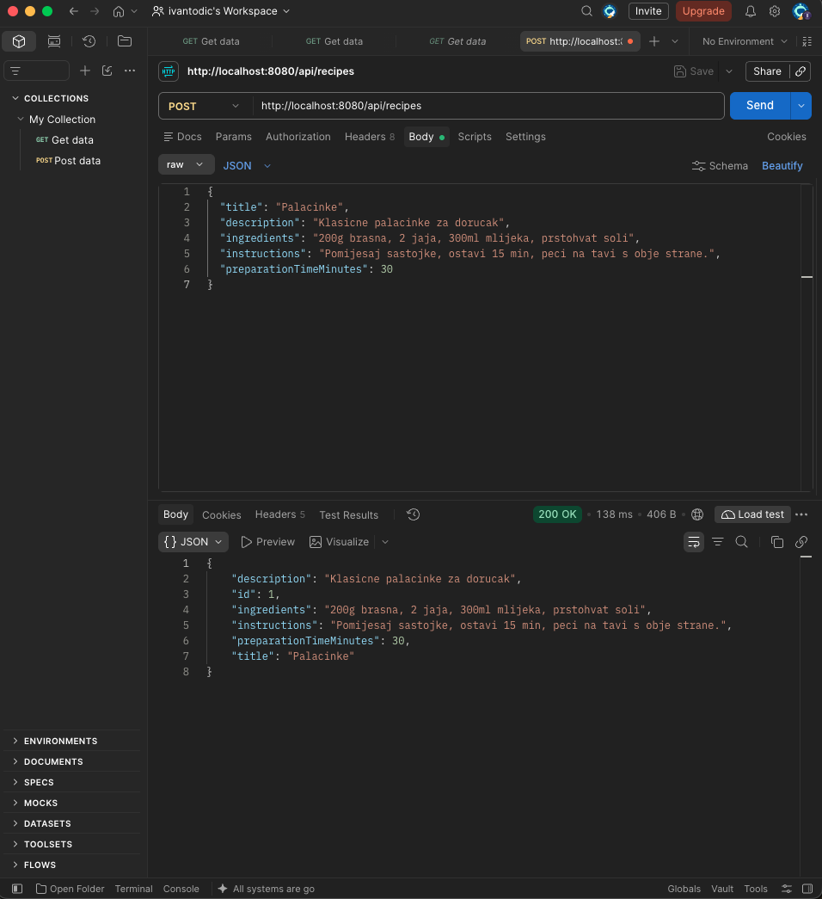
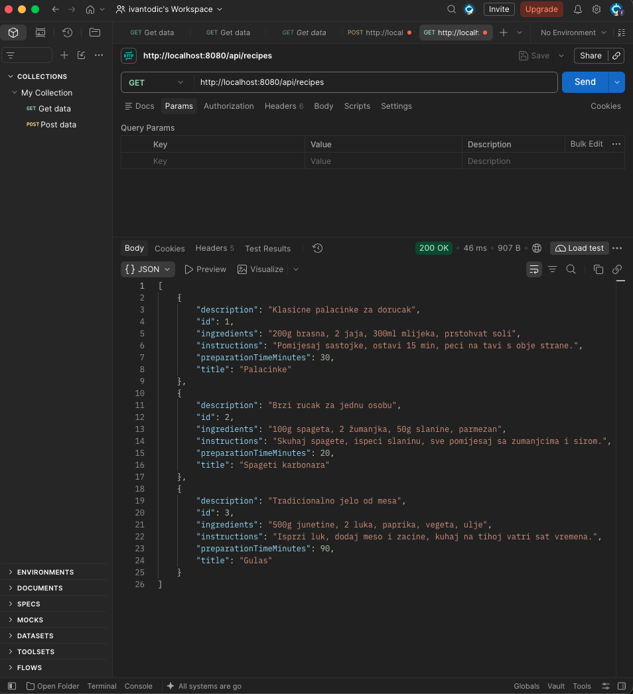
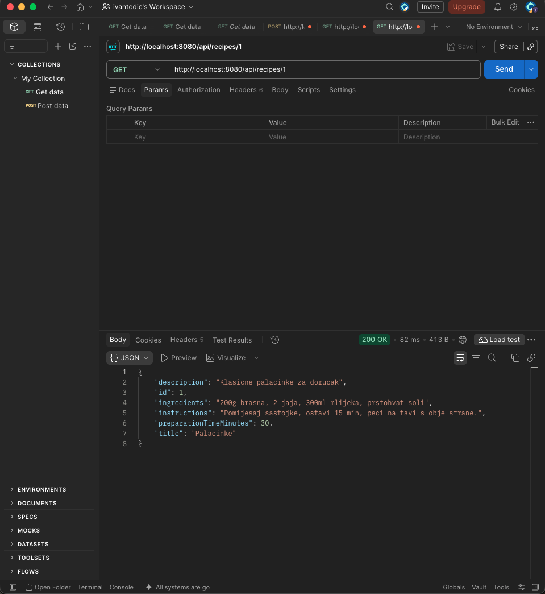
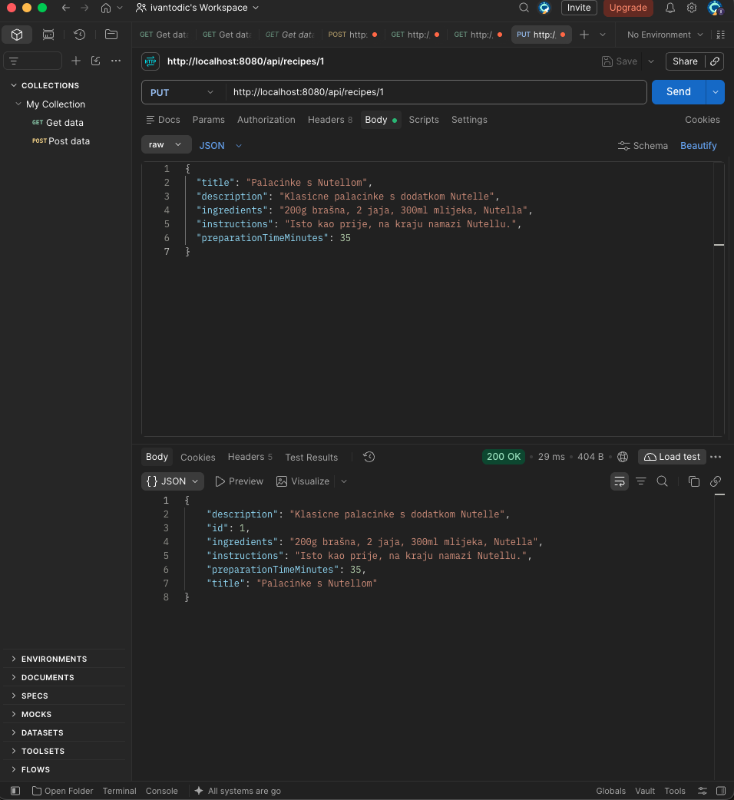
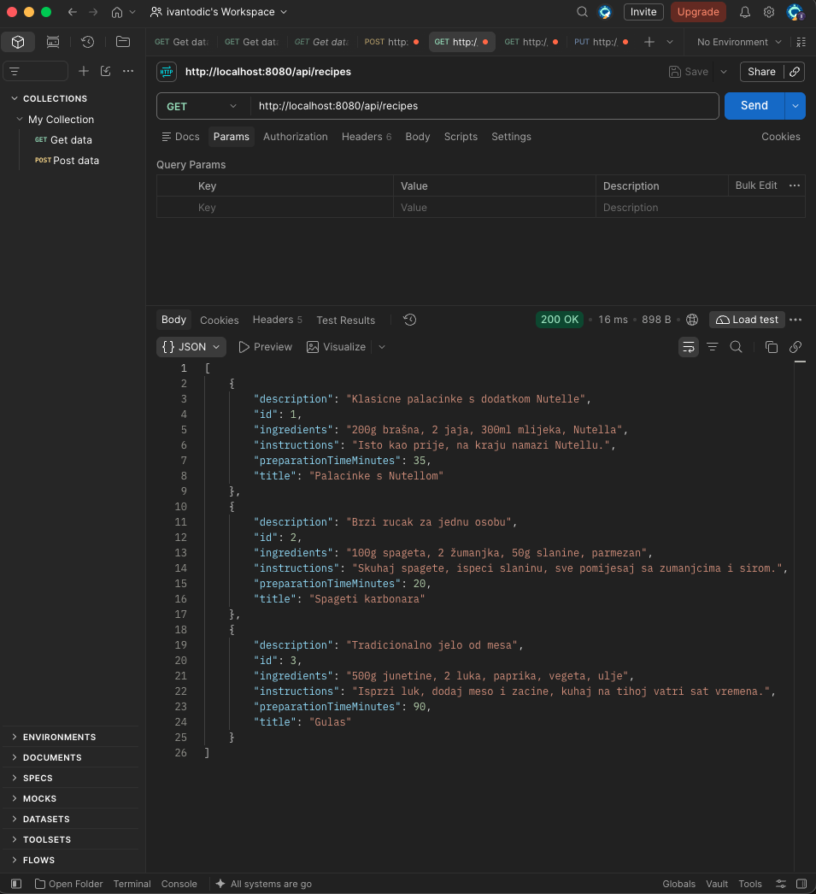
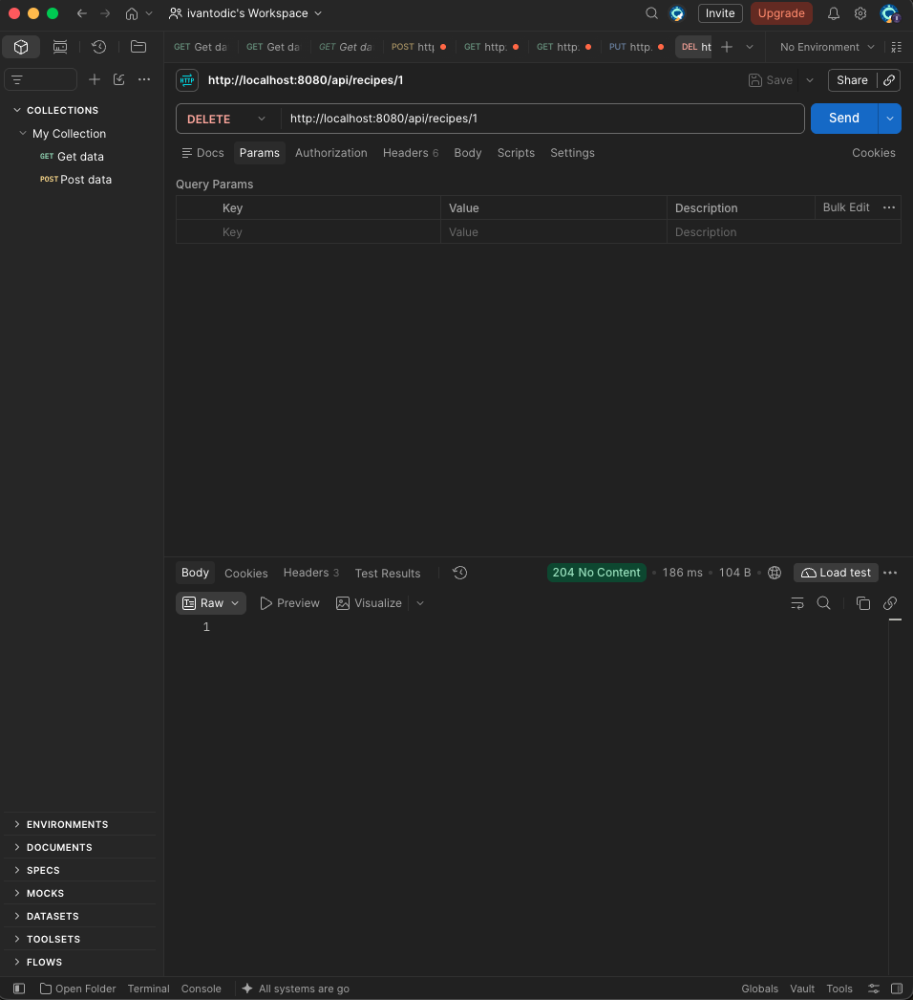
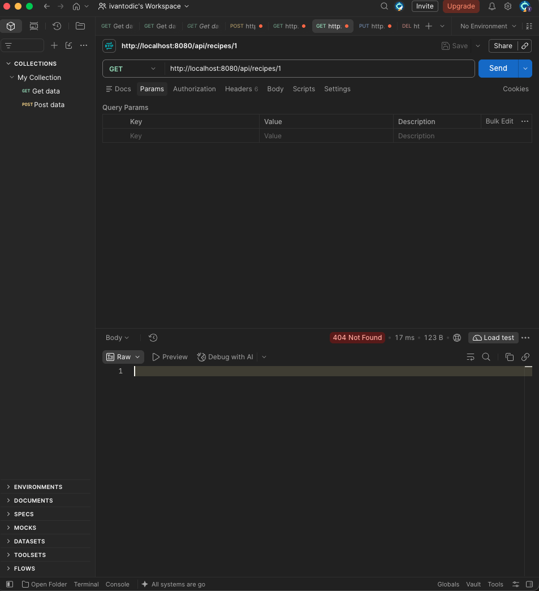

# Vaja 1: Vzpostavitev delovnega okolja - CRUD

**Avtor:** Ivan Todić
**Izbrana aplikacija:** Aplikacija z recepti

## Idejna zasnova

Aplikacija omogoča uporabnikom shranjevanje, urejanje in pregledovanje kuharskih receptov. Vsak recept vsebuje naslov, kratek opis, sestavine, navodila za pripravo in čas priprave. V prihodnjih nalogah bom aplikacijo nadgradil z uporabniškim vmesnikom, povezavo na zunanjo bazo podatkov ter dodatnimi funkcijami, kot so iskanje, filtriranje in kategorije receptov.

## Uporabljene tehnologije

- Java 21, Spring Boot (Spring Web, Spring Data JPA)
- H2 baza podatkov v pomnilniku
- Maven
- Postman za testiranje

## Struktura projekta

- `backend/` – SpringBoot zaledni sistem (REST API na naslovu `/api/recipes`)

## Testiranje CRUD operacij

### Create – dodajanje recepta (POST /api/recipes)

### Read – vsi zapisi (GET /api/recipes)

### Read – en zapis (GET /api/recipes/1)

### Update – urejanje recepta (PUT /api/recipes/1)

Preverjanje, da se je podatek spremenil:

### Delete – brisanje recepta (DELETE /api/recipes/1)

Preverjanje, da zapis ne obstaja več (404):

